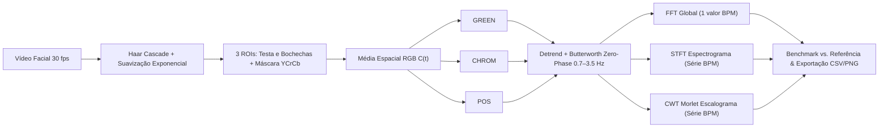
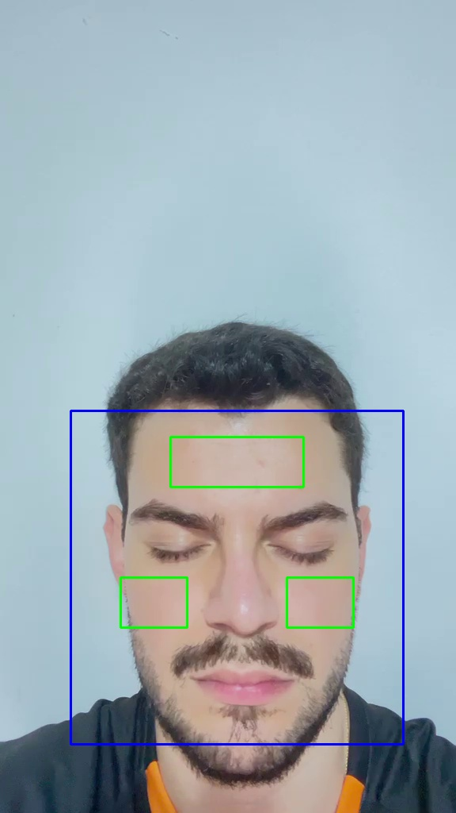
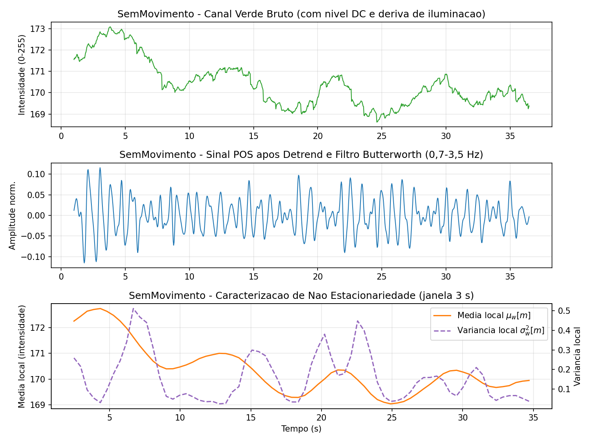
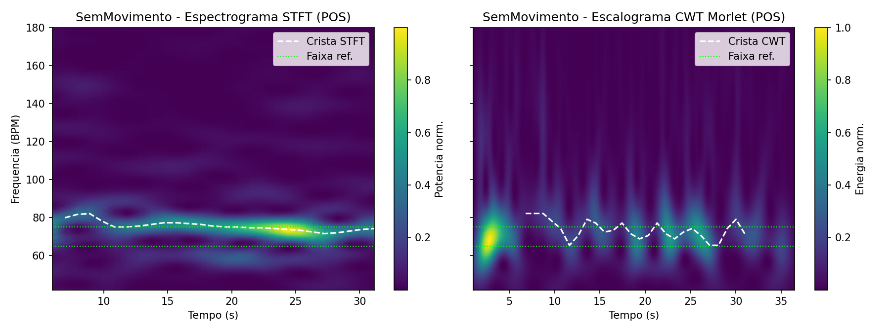

#  Estimação de Frequência Cardíaca sem Contato via Visão Computacional e Processamento Digital de Sinais (rPPG)


> **Pipeline ponta a ponta de Fotopletismografia Remota (rPPG)** capaz de extrair sinais biomédicos a partir de variações microscópicas de refletância da pele capturadas por câmeras comuns de smartphone, confrontando modelos ópticos de extração (**GREEN**, **CHROM**, **POS**) e representações espectrais e tempo-frequência (**FFT**, **STFT** e **CWT de Morlet**).

---

##  Visão Geral e Impacto do Projeto:

A medição convencional da frequência cardíaca (FC) exige contato físico (eletrodos de ECG ou oxímetros de pulso), o que é inviável ou desconfortável em monitoramento neonatal, pacientes queimados, telemedicina e detecção de fadiga veicular.

Este projeto implementa um sistema completo de **engenharia biomédica e processamento de sinais** que transforma vídeos faciais comuns (30 fps, comprimidos por smartphone) em séries temporais de batimentos cardíacos por minuto (BPM), acompanhado de um **artigo científico completo** desenvolvido na disciplina de *Análise de Sistemas Lineares (UTFPR — Campus Apucarana)*.

### Destaques de Engenharia
* **Visão Computacional Robusta:** Detecção facial via *Haar Cascade* com **suavização exponencial de caixa delimitadora** ($b_t = 0{,}85\,b_{t-1} + 0{,}15\,d_t$), segmentação geométrica de 3 ROIs (testa e bochechas) e filtragem de pele no espaço de cor **YCrCb**.
* **Modelagem Bio-Óptica:** Implementação comparativa de 3 algoritmos clássicos da literatura: **GREEN** (Verkruysse et al., 2008), **CHROM** (de Haan & Jeanne, 2013) e **POS — *Plane-Orthogonal-to-Skin*** (Wang et al., 2017).
* **Condicionamento LTI em Fase Zero:** Remoção de tendência linear (*detrend*) seguida de filtro passa-faixa **Butterworth IIR de 3ª ordem** ($0{,}7\text{–}3{,}5\text{ Hz}$ / $42\text{–}210\text{ BPM}$) aplicado via `filtfilt` para evitar distorção de fase e atraso de grupo.
* **Análise Espectral e Tempo-Frequência:** Confronto direto entre **FFT global**, **Espectrograma (STFT)** e **Escalograma via Transformada Wavelet Contínua (CWT com Wavelet de Morlet complexa)**, evidenciando na prática o **Princípio da Incerteza de Heisenberg-Gabor**.
* **Validação Estrutural Multi-Dataset:** Pipeline validado em gravações próprias (iPhone 13 4K @ 30 fps com referência de smartwatch em repouso e pós-esforço com movimento) e scripts de inspeção/normalização compatíveis com a base pública **UBFC-rPPG**.

---

##  Fundamentação Teórica:

### 1. Fenômeno Biofotométrico e Extração RGB
A cada sístole cardíaca, o aumento transitório do volume sanguíneo nos capilares da derme altera a absorção óptica da pele — fenômeno mais pronunciado na faixa do verde ($\lambda \approx 520\text{–}570\text{ nm}$), pico de absorção da oxi-hemoglobina. Como essa modulação é da ordem de décimos de intensidade em 8 bits, o pipeline extrai a média espacial $\mathbf{C}(t) = [R(t), G(t), B(t)]^T$ sobre milhares de pixels cutâneos e projeta o sinal para isolar o pulso de reflexões especulares e variações de iluminação:

* **GREEN:** Explora diretamente o canal verde médio da ROI: $x_{\text{GREEN}}(t) = \frac{1}{\vert{}\Omega\vert{}}\sum_{(u,v)\in\Omega} I_G(u,v,t)$.
* **CHROM:** Projeta os canais normalizados em um plano ortogonal de crominância para cancelar movimento rígido: $x_{\text{CHROM}}(t) = X_s(t) - \alpha Y_s(t)$, com $\alpha = \sigma(X_s)/\sigma(Y_s)$.
* **POS (*Plane-Orthogonal-to-Skin*):** Projeta o vetor RGB normalizado temporalmente (janelas de $1{,}6\text{ s}$ com *overlap-add*) sobre o plano ortogonal ao vetor de tom de pele utilizando a matriz $P = \begin{bmatrix} 0 & 1 & -1 \\ -2 & 1 & 1 \end{bmatrix}$, dispensando parâmetros empíricos.

### 2. Amostragem, Não Estacionariedade e Filtragem LTI
Operando a $f_s = 30\text{ Hz}$ ($f_{\text{Nyquist}} = 15\text{ Hz}$), o sistema respeita com folga o Teorema de Nyquist-Shannon para a banda cardíaca humana ($f \in [0{,}7\text{ Hz}, 3{,}5\text{ Hz}]$). O sinal bruto apresenta forte componente DC ($\approx 170$ níveis) e derivas lentas de iluminação, comprovadas por meio de **média local $\mu_w[m]$ e variância local $\sigma_w^2[m]$ em janelas deslizantes de 3 s**. O filtro Butterworth passa-faixa em fase zero elimina o nível DC e ruídos de alta frequência sem deslocar os picos temporais da onda de pulso.

### 3. FFT vs. STFT vs. CWT (Incerteza de Heisenberg-Gabor)
| Técnica | Formulação / Parâmetros | Resolução Tempo-Frequência | Vantagem / Limitação no rPPG |
| :--- | :--- | :--- | :--- |
| **FFT Global** | $N_{\text{FFT}} = \max(4096, 4 \cdot 2^{\lceil \log_2 N \rceil})$ | Máxima resolução espectral ($\Delta f = 1/T$), **zero** localização temporal | Ideal para sinais estacionários em repouso; falha sob variação dinâmica ou ruído transitório localizado. |
| **STFT** | Janela de Hann $N_w = 300$ ($10\text{ s}$), passo $R = 30$ ($1\text{ s}$) | **Fixa** ($\Delta t \cdot \Delta \omega \ge 1/2$), $\Delta f = 0{,}1\text{ Hz}$ ($6\text{ BPM}$) | Atua como suavizador temporal robusto contra ruídos impulsivos, mas borra transientes rápidos. |
| **CWT (Morlet)** | Wavelet `cmor2.0-0.955` ($\omega_0 = 6$), $128$ escalas logarítmicas | **Adaptativa (Multiescala)**: alta resolução temporal em altas frequências e alta resolução espectral em baixas | Captura transientes imediatos com precisão, porém exige rastreamento de crista (*ridge tracking*) sob movimento intenso. |

---

##  Arquitetura do Pipeline:



---

##  Resultados Experimentais e Visualizações:

Os experimentos confrontaram 18 combinações ($2\text{ cenários} \times 3\text{ métodos} \times 3\text{ transformadas}$) sob iluminação natural:
1. **`SemMovimento`** (Repouso — Referência Smartwatch: **65–75 BPM**).
2. **`ComMovimento`** (Pós-esforço com movimentação facial — Referência Smartwatch: **90–100 BPM**).

### Tabela Comparativa de Desempenho (Resumo)

| Cenário | Método | Transformada | BPM Estimado (Média/Pico) | Mín – Máx (BPM) | Desvio Padrão | Ref. (BPM) | Erro Abs. (Centro) | Na Faixa? |
| :--- | :---: | :---: | :---: | :---: | :---: | :---: | :---: | :---: |
| **SemMovimento** | **POS** | **FFT** | **73,6** | 73,6 – 73,6 | 0,00 | 65–75 | **3,6** | ✅ Sim |
| **SemMovimento** | **POS** | **CWT** | **73,7** | 65,4 – 82,2 | 4,93 | 65–75 | **3,7** | ✅ Sim |
| **SemMovimento** | **CHROM** | **FFT** | **73,4** | 73,4 – 73,4 | 0,00 | 65–75 | **3,4** | ✅ Sim |
| **SemMovimento** | **GREEN** | **FFT** | 61,3 | 61,3 – 61,3 | 0,00 | 65–75 | 8,7 | ❌ Não |
| **SemMovimento** | **GREEN** | **STFT** | **72,9** | 60,2 – 81,7 | 6,42 | 65–75 | **2,9** | ✅ Sim |
| **SemMovimento** | **GREEN** | **CWT** | **69,2** | 55,5 – 82,2 | 7,50 | 65–75 | **0,8** | ✅ Sim |
| **ComMovimento** | **POS** | **FFT** | 73,8 | 73,8 – 73,8 | 0,00 | 90–100 | 21,2 | ❌ Não |
| **ComMovimento** | **POS** | **CWT** | 76,1 | 60,7 – 143,6 | 20,94 | 90–100 | 18,9 | ❌ Não |

### Principais Descobertas Técnicas
* **Precisão do Método POS em Repouso:** Convergência consistente entre domínio global (**73,6 BPM** na FFT) e multiescala (**73,7 BPM** na CWT), ambos dentro da faixa fisiológica esperada.
* **Correção de Viés Sub-Harmônico pela Análise Tempo-Frequência:** No canal `GREEN`, a FFT global falhou (**61,3 BPM**) devido a uma queda local entre $18{,}6\text{ s}$ e $22{,}4\text{ s}$. Tanto a **STFT (72,9 BPM)** quanto a **CWT (69,2 BPM)** isolaram o distúrbio no tempo e recuperaram a FC com erro de até **0,8 BPM** em relação ao centro da referência.
* **Diagnóstico Crítico sob Movimento Intenso:** Movimentos faciais periódicos introduzem energia óptica na mesma banda cardíaca ($0{,}7\text{–}3{,}5\text{ Hz}$), fazendo estimadores baseados puramente em pico máximo (`argmax`) travarem na cadência mecânica ($\approx 73{,}8\text{ BPM}$). Isso delimita claramente a fronteira para trabalhos futuros: *ridge tracking* dinâmico no escalograma e cancelamento adaptativo via vetores de movimento facial.

### Evidências Visuais Geradas Automaticamente pelo Pipeline

| Detecção Facial e ROIs Cutâneas (YCrCb) | Sinal Bruto vs. Filtrado e Não Estacionariedade | Espectrograma (STFT) vs. Escalograma (CWT) |
| :---: | :---: | :---: |
|  |  |  |

---

##  Estrutura do Repositório:

```text
Artigo_ASL/
├── rppg_batimentos.py              # Pipeline principal: Visão Computacional, GREEN/CHROM/POS, FFT/STFT/CWT e plots
├── import os.py                    # Leitor e normalizador em Python para a base pública UBFC-rPPG (DATASET_1 e 2)
├── ubfcrppg_data_processor.m.txt   # Script de referência em MATLAB para leitura da base UBFC-rPPG
├── resultados/                     # Artefatos experimentais reproduzíveis (CSV e figuras em alta resolução)
│   ├── resumo.csv                  # Tabela consolidada das 18 combinações avaliadas
│   ├── SemMovimento_bpm.csv        # Séries temporais de BPM (STFT e CWT) em repouso
│   ├── ComMovimento_bpm.csv        # Séries temporais de BPM (STFT e CWT) com movimento
│   ├── *_roi.jpg                   # Preview da detecção Haar Cascade e máscaras de pele
│   ├── *_bruto_vs_filtrado.png     # Análise de deriva DC, filtragem Butterworth e média/variância deslizantes
│   ├── *_sinal.png                 # Sinal rPPG condicionado (POS) e espectro de potência via FFT
│   ├── *_tempo_frequencia.png      # Confronto lado a lado: Espectrograma (STFT) vs. Escalograma (CWT)
│   └── *_bpm_tempo.png             # Evolução temporal comparativa entre métodos e transformadas
└── .gitignore                      # Omite vídeos brutos (*.mp4) para preservação de privacidade
```

---

##  Como Executar na Prática:

### 1. Pré-requisitos e Instalação
Recomenda-se Python 3.10+ em ambiente virtual (`venv` ou `conda`):

```bash
git clone [https://github.com/eLivrari/Artigo_ASL.git](https://github.com/eLivrari/Artigo_ASL.git)
cd Artigo_ASL

python -m venv .venv
source .venv/bin/activate  # Linux/macOS
# .venv\Scripts\activate   # Windows

pip install numpy scipy matplotlib opencv-python pywavelets pandas
```

### 2. Executando o Pipeline de Estimação rPPG
> **Nota de Privacidade:** Os vídeos originais da coleta própria (`SemMovimento.mp4` e `ComMovimento.mp4`) são omitidos via `.gitignore` para preservar a imagem do voluntário, mas o pipeline processa qualquer vídeo facial frontal (30 fps) com áudio/imagem padrão.

**Execução padrão (processa `SemMovimento.mp4` e `ComMovimento.mp4` na raiz):**
```bash
python rppg_batimentos.py
```

**Execução customizada com seus próprios vídeos e faixas de referência (CLI):**
```bash
python rppg_batimentos.py caminho/para/meu_video.mp4 \
  --ref meu_video=68-78 \
  --saida resultados_customizados/
```

Ao final da execução, o script gera automaticamente os **5 gráficos diagnósticos**, as **séries temporais em `.csv`** e a **tabela consolidada `resumo.csv`** na pasta de saída.

### 3. Inspeção da Base Pública UBFC-rPPG (Opcional)
Para validar o carregamento dos sinais de oxímetro de pulso de contato (`gtdump.xmp` ou `ground_truth.txt`) da base [UBFC-rPPG](https://sites.google.com/view/ybenezeth/ubfcrppg):

```bash
python "import os.py"
```

---

##  Stack Tecnológica e Competências Aplicadas:

* **Linguagens:** Python, MATLAB
* **Processamento Digital de Sinais (DSP):** `SciPy` (`scipy.signal.butter`, `filtfilt`, `detrend`, `fft`, `stft`), `PyWavelets` (`pywt.cwt` com Wavelet de Morlet complexa)
* **Visão Computacional:** `OpenCV` (`CascadeClassifier`, conversão de espaço de cor `YCrCb`, rastreamento suavizado de ROIs)
* **Análise de Dados & Visualização Científica:** `NumPy`, `Pandas`, `Matplotlib`

---

##  Próximos Passos (Roadmap Técnico):

- [ ] **Rastreamento Adaptativo de Cristas (*Ridge Tracking*):** Substituir o `argmax` frame a frame no escalograma CWT por programação dinâmica / algoritmo de Viterbi para evitar saltos espúrios durante artefatos de movimento.
- [ ] **Cancelamento Adaptativo de Ruído (ANC):** Utilizar o deslocamento espacial da caixa delimitadora facial como sinal de referência de movimento para filtragem adaptativa (LMS/RLS).
- [ ] **Benchmark Automatizado no UBFC-rPPG:** Expandir a avaliação quantitativa (MAE, RMSE, Pearson $r$ e Bland-Altman) para todos os 42 sujeitos do `DATASET_2`.

---

##  Autores:

* **Enzo Livrari** — *Engenharia de Computação, UTFPR Apucarana* • [GitHub](https://github.com/eLivrari)
* **Lucas Dutra** — *Engenharia de Computação, UTFPR Apucarana* • [GitHub](https://github.com/LK-DTR) 
* **Felipe de Paula** — *Engenharia de Computação, UTFPR Apucarana* • [GitHub](https://github.com/Felipex28)
* **Maria Eduarda** — *Engenharia de Computação, UTFPR Apucarana* • [GitHub](https://github.com/mariaeduardaquedas) 
* **Matheus Oliveira Pardinho** — *Engenharia de Computação, UTFPR Apucarana* • [GitHub](https://github.com/matheusopardinho2006)
